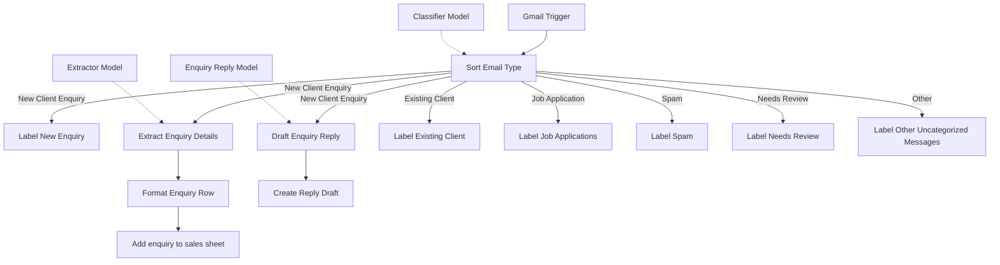
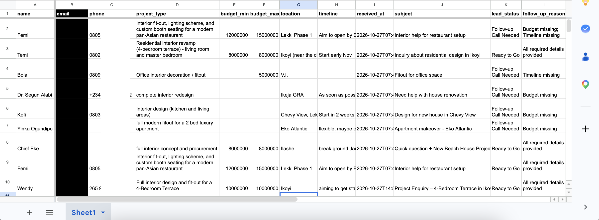
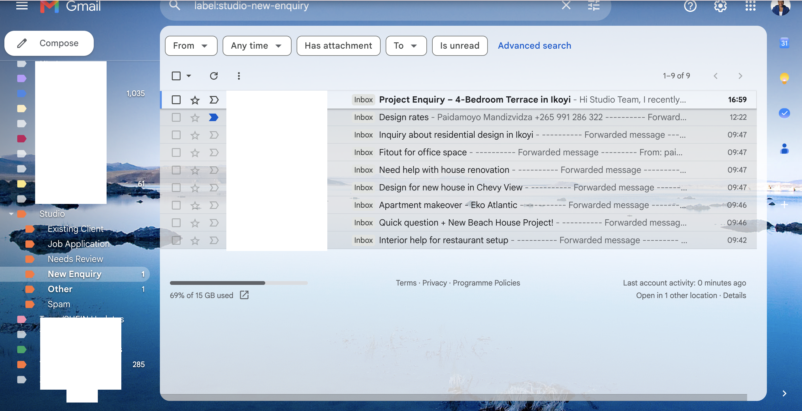

# Gmail Inbox Sorter and Enquiry Capture for an Interior Design Studio

An n8n workflow that sorts every new email in a studio's Gmail inbox into one of six routes, labels it, and writes new client enquiries into a Google Sheet that a sales person can call from.

I built this for a practice client brief (a Lagos interior design studio with one shared inbox). The brief and every test email are my own, so no real client data is in this repository.

## What I built

The studio's inbox mixed new enquiries, updates from current clients, job applications, vendor pitches and junk. An assistant read each email and copied the details of new enquiries into a spreadsheet by hand, and good leads went cold because nobody got back to them in time.

The workflow starts with a Gmail Trigger that checks for new mail every minute. A Text Classifier reads the subject and body and picks one of six categories, and each category has its own Gmail label so the right person can find it. New client enquiries also go through an extractor that pulls out the name, email, phone, project type, budget, location and timeline, and the result is appended to a Google Sheet as one row with the same columns every time. A budget written in words ("about eight million") becomes a number, and a budget the client never gave stays empty.

## How it works

1. **Gmail Trigger** polls the inbox every minute and returns the full message, including the plain text body.
2. **Sort Email Type** (a Text Classifier, with **Classifier Model** attached) reads the subject and body and chooses exactly one category: New Client Enquiry, Existing Client, Job Application, Spam, Needs Review or Other. Each category has a written description that says what belongs in it and what does not.
3. Five of the six categories end at a Gmail label: **Label Existing Client**, **Label Job Applications**, **Label Spam**, **Label Needs Review** and **Label Other Uncategorized Messages**. Nothing is deleted or archived.
4. New Client Enquiry fans out three ways: **Label New Enquiry**, **Extract Enquiry Details** and **Draft Enquiry Reply**.
5. **Extract Enquiry Details** (an Information Extractor, with **Extractor Model** attached) returns name, email, phone, project_type, budget_min, budget_max, location and timeline. Its budget instructions tell the model to ignore property prices and rent, to convert words and shorthand such as "5m" into whole numbers, and to leave the field empty when no amount is stated.
6. **Format Enquiry Row** (an Edit Fields node) builds the final row. It adds received_at and subject from the original email, and two fields I added for the sales person: lead_status ("Ready to Go" when there is a budget and a timeline, otherwise "Follow-up Call Needed") and follow_up_reason.
7. **Add enquiry to sales sheet** appends the row to Google Sheets with the cell format set to raw, so phone numbers such as `+234 803 111 2222` and leading zeros are stored as written.
8. **Draft Enquiry Reply** (a Basic LLM Chain, with **Enquiry Reply Model** attached) writes a short, polite reply to the enquiry, and **Create Reply Draft** saves it as a Gmail draft for a person to review and send.

## Key benefits

- Every email ends up on a route and carries a Gmail label, so none disappear, including the ones that fit no category.
- New enquiries come out with the same columns every time, ready to paste into or read from a spreadsheet.
- A missing budget stays empty instead of being guessed, which was the main complaint about the manual process.
- Budgets written as words or shorthand become real numbers that can be sorted and filtered.
- The sales person can see at a glance which leads are ready to call and which need a follow-up call first, and why.

## Tech stack

| Part | Tool |
|---|---|
| Automation | n8n |
| Trigger and labels | Gmail (Gmail Trigger and Gmail nodes, OAuth2) |
| Sorting, extraction and reply drafts | OpenAI chat model `gpt-5-mini` through n8n's Text Classifier, Information Extractor and Basic LLM Chain nodes |
| Data store | Google Sheets |

The OpenAI nodes in my export used credentials managed by n8n. On your own instance you attach your own OpenAI credential.

## Setup

1. Import `workflow.json` into n8n (Workflows, menu, Import from File).
2. Create the Gmail, Google Sheets and OpenAI credentials described in [docs/credentials.md](docs/credentials.md) and attach them to the nodes.
3. In Gmail, create one label for each of the six categories, then pick them in the six Add Label nodes.
4. Create a Google Sheet with the twelve column headers listed in [docs/setup.md](docs/setup.md), format the phone column as plain text, and select it in the Google Sheets node.
5. Replace `YOUR_STUDIO_NAME` in the Draft Enquiry Reply prompt.
6. Run a few test emails, check the labels and the sheet, then activate the workflow. The full steps and troubleshooting are in [docs/setup.md](docs/setup.md).

## Example

A short enquiry arrives (all names here are made up, see `sample-data/`):

> Hi, we bought a 3 bedroom flat in Lekki Phase 1 and want the living room and kitchen redone. Budget is about six million naira and we would like to start in January. Chinedu 08012340000 chinedu@example.com

It is labelled as a new enquiry, and this row is added to the sheet:

| name | email | phone | project_type | budget_min | budget_max | location | timeline | lead_status |
|---|---|---|---|---|---|---|---|---|
| Chinedu | chinedu@example.com | 08012340000 | living room and kitchen redesign | 6000000 | 6000000 | Lekki Phase 1 | start in January | Ready to Go |

The full input and output files are in `sample-data/input-example.json` and `sample-data/output-example.json`. A second example in the output file shows an enquiry with no budget or timeline, which comes out with empty cells and "Follow-up Call Needed".

## Customizing it

- **Categories:** edit the names and descriptions in **Sort Email Type**. The descriptions do most of the work, so most of my tuning went there, especially the lines that say what each category does not include.
- **What gets extracted:** add or change attributes in **Extract Enquiry Details**, then add matching fields in **Format Enquiry Row** and columns in the sheet.
- **Budget rules:** the wording is in the `budget_min` and `budget_max` attribute descriptions.
- **Lead status:** the two expressions in **Format Enquiry Row** decide what counts as ready to go.
- **Where things go:** replace the Google Sheets node with another destination, or add notification nodes after the label nodes.
- **Reply tone:** edit the prompt in **Draft Enquiry Reply**.

## Limitations

- The classifier only has the text of the email. There is no client list to check, so an existing client who writes without mentioning a project may not be recognised as one. A current client asking about a brand new project is sent down the enquiry route on purpose, and the sheet does not mark them as an existing client.
- When a client wrote a figure as a maximum ("N5m max"), my tests filled budget_max only and left budget_min empty.
- The email column falls back to the sender's address when the client does not write one in the message. That fallback depends on the extractor model using the sender line I pass in, so it is worth spot checking.
- Spam is labelled and left in the inbox, and nothing is archived.
- I did not set model options such as temperature, so results can vary slightly between runs.
- I tested the sorting and extraction on 15 emails that I wrote. The reply drafts and lead_status were added afterwards, so check a few of them on your own data. Also open one saved draft in Gmail and confirm the To address is filled, because the export sets a Reply-To value and I did not see a To address set.
- The sheet has no duplicate check, so the same email can be added twice if the workflow is run on it twice.

## Conclusion

This project shows how I handle messy, human-written input: the classifier descriptions were rewritten after I tested real misses (a vendor pitch landing in Spam, a neighbour's complaint landing in Existing Client), and the extractor rules were tightened until a property price and an undecided budget stopped producing numbers. The part I would add next is a lookup against the studio's real client list, which would make the Existing Client route reliable without depending on what the email happens to say.

## Author

Paidamoyo Mandizvidza
