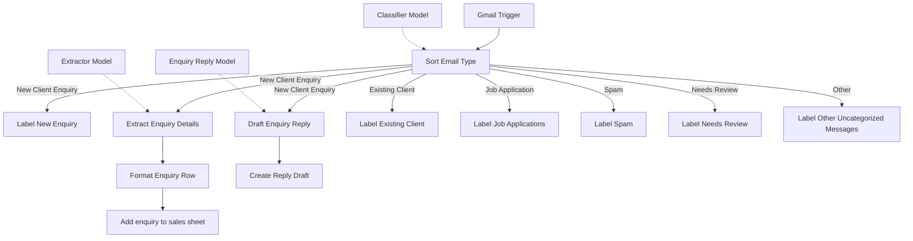

# Architecture

## Flow

## Nodes in execution order

| Node | Type | What it does |
|---|---|---|
| Gmail Trigger | Gmail Trigger | Polls every minute for new messages. Simplify is off, so the full plain text body, the parsed sender and the raw headers are returned. No filters are set. |
| Sort Email Type | Text Classifier | Reads `Subject:` and `Body:` and assigns exactly one of six categories (multiple classes is off). The descriptions of the categories are the real logic. |
| Classifier Model | OpenAI Chat Model | `gpt-5-mini`, attached to Sort Email Type. |
| Label New Enquiry | Gmail, Add Label | Labels the original message by its `id`. |
| Extract Enquiry Details | Information Extractor | Pulls eight attributes from subject, sender line and body. |
| Extractor Model | OpenAI Chat Model | `gpt-5-mini`, attached to Extract Enquiry Details. |
| Format Enquiry Row | Edit Fields | Maps the extractor output to flat columns, adds `received_at` and `subject` from the classifier's input, and computes `lead_status` and `follow_up_reason`. |
| Add enquiry to sales sheet | Google Sheets, Append | Appends the row. Cell format is raw. Mapping is automatic by column name. |
| Draft Enquiry Reply | Basic LLM Chain | Writes a reply to the enquiry from a fixed set of instructions. |
| Enquiry Reply Model | OpenAI Chat Model | `gpt-5-mini`, attached to Draft Enquiry Reply. |
| Create Reply Draft | Gmail, Create Draft | Saves the reply as a draft with subject `Re:` plus the original subject (any existing `Re:` prefix is removed first). |
| Label Existing Client | Gmail, Add Label | Labels messages in the Existing Client category. |
| Label Job Applications | Gmail, Add Label | Labels messages in the Job Application category. |
| Label Spam | Gmail, Add Label | Labels messages in the Spam category. |
| Label Needs Review | Gmail, Add Label | Labels messages in the Needs Review category. |
| Label Other Uncategorized Messages | Gmail, Add Label | Labels messages in the Other category. |

## The six categories

| Category | Intended for | Written exclusions that matter |
|---|---|---|
| New Client Enquiry | Prospective clients, referrals, and current clients asking about a new project. Short rate or availability questions count even with little detail. | Updates and invoices on existing work. |
| Existing Client | Messages about a specific project, site, design, invoice or delivery that the studio is doing or has done for the sender. | Third parties such as neighbours, and any email that does not show the sender is a client. |
| Job Application | Employment, internship, contract or freelance requests, including emails that praise the studio's work while offering services. | Real project enquiries. |
| Spam | Scams, phishing, fake urgency, domain or ranking warnings, vouchers, guaranteed SEO, and unrelated mass marketing. | Legitimate trade vendors and suppliers, which go to Needs Review. |
| Needs Review | Vendor and supplier pitches, event invitations, announcements, press requests, third-party complaints, and anything ambiguous that needs a person. | New enquiries, client updates, applications and scams. |
| Other | Public or community messages unrelated to the studio's business, and mistaken or irrelevant messages. | Enquiries, client updates, applications, trade pitches and scams. |

## Extraction rules

- `name`: the name written in the email body, such as the sign-off, and the sender's display name only when the body has none.
- `phone`: copied exactly as written, keeping a leading zero or a `+234` prefix, ignoring other numbers such as house numbers or prices, and left empty when there is none.
- `budget_min` and `budget_max`: numbers. A single figure fills both. A range fills the lower and upper figures. Words and shorthand become whole numbers without symbols or commas. Property prices, rent and site costs are ignored. No stated amount, or an undecided budget, stays empty.
- `email`, `project_type`, `location`, `timeline`: short descriptions only. The extractor is given a `Sender:` line so that it can fall back to the sender's address.

## Row shape

`Format Enquiry Row` always produces the same twelve fields: `name`, `email`, `phone`, `project_type`, `budget_min`, `budget_max`, `location`, `timeline`, `received_at`, `subject`, `lead_status`, `follow_up_reason`.

- Missing `phone` and `timeline` become empty strings.
- Missing budgets become `null`, so they stay empty in the sheet. Number fields would otherwise turn an empty string into 0, which looks like a stated budget.
- `lead_status` is "Ready to Go" when at least one budget figure and a timeline are present, and "Follow-up Call Needed" otherwise.
- `follow_up_reason` lists what is missing ("Budget missing", "Timeline missing") or says "All required details provided".

## Open questions for the client

These were the three questions I wrote for the studio owner before building. The answers change the build, so each one has the assumption I used in the meantime.

1. **How can we tell whether an email comes from an existing client, and where should a current client's request for a new project go?** I assumed there is no client list. The classifier judges from the email text, and a current client asking about a new project goes down the enquiry route.
2. **Who reviews emails that fit none of the main categories, and where should they see them?** I assumed a Gmail label that the assistant checks, with nothing deleted or archived.
3. **Where should vendor pitches and newsletters go, and should spam be hidden or kept visible?** I assumed vendors are not spam and go to Needs Review, and that spam is labelled but left in the inbox until the studio decides otherwise.
